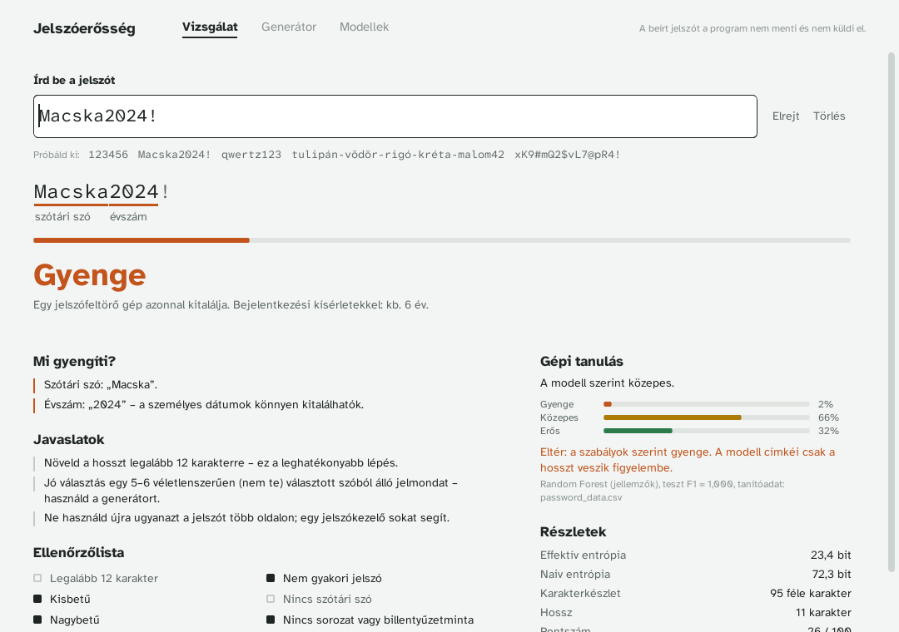
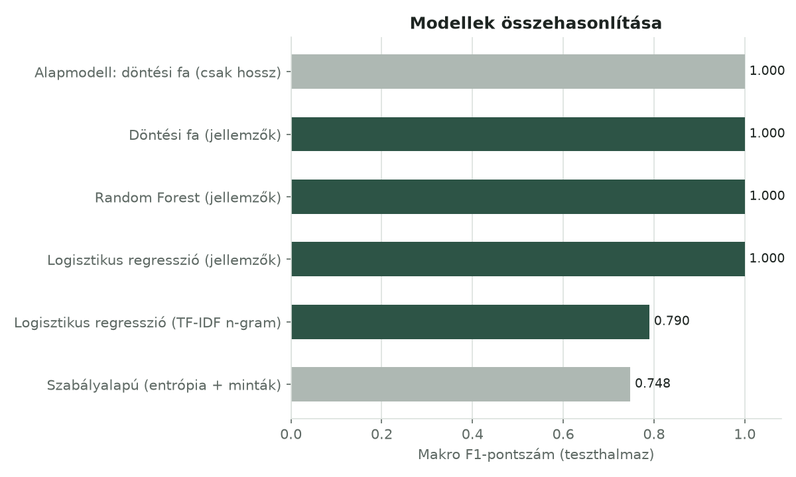

# Jelszóerősség-vizsgáló

Python asztali alkalmazás (CustomTkinter), amely egy jelszó erősségét **két független
módszerrel** értékeli, és az eredményeket összeveti:

1. **Szabályalapú értékelés** – effektív entrópia becslése mintafelismeréssel
   (szótári szavak, leetspeak, sorozatok, billentyűzetminták, ismétlődések,
   évszámok/dátumok, gyakori jelszavak, a felhasználó személyes adatai) és becsült
   feltörési idő. A gyakori jelszavak listája több mint 10 000 elemű (SecLists),
   mellette saját magyar szótár; mindkettő szövegfájlból töltődik be.
2. **Gépi tanulás** – a Kaggle *Password Strength Classifier* adathalmazon
   tanított osztályozók (Random Forest, döntési fa, logisztikus regresszió,
   TF-IDF karakter n-gram modell), egységes kiértékeléssel és 5-szörös
   keresztvalidációval.


A felület CustomTkinterrel készült, világos témával; a betűtípus a jól olvasható Atkinson Hyperlegible, amelyben az összetéveszthető jelek (l, 1, I, 0, O) jól megkülönböztethetők.



## Telepítés

Python 3.10 vagy újabb szükséges.

A projekt mappájában (ahol a `main.py` van):

```bash
python -m pip install -r requirements.txt
```

Windowson, ha a `python` parancs nem működik, használd a `py` parancsot:
`py -m pip install -r requirements.txt`, majd `py main.py`.

A Tkinter Windowson és macOS-en a python.org telepítőjének része (a „tcl/tk and
IDLE” opció). Linuxon külön csomag: `sudo apt install python3-tk`.

## Futtatás

```bash
python main.py                  # grafikus felület
python main.py --cli            # parancssori mód, rejtett jelszóbekéréssel
python main.py --cli "Jelszo1"  # parancssori mód, közvetlen jelszóval
```

A csomag tartalmaz egy előre betanított modellt (`models/best_model.joblib`),
így a program azonnal használható.

## Modell tanítása

1. Töltsd le az adathalmazt, és másold `data.csv` néven a `data/` mappába:
   - eredeti forrás: [Kaggle – Password Strength Classifier Dataset](https://www.kaggle.com/datasets/bhavikbb/password-strength-classifier-dataset)
   - a mellékelt modell ebből a nyilvános másolatból készült:
     [Aslm-Fawzy/Password-Strength-Detection](https://github.com/Aslm-Fawzy/Password-Strength-Detection) (`password_data.csv`)

   Részletek: [`data/README.md`](data/README.md).
2. Futtasd:

```bash
python train.py                         # data/data.csv, max. 200 000 sor
python train.py --max-rows 0            # a teljes adathalmaz (~670 000 sor)
python train.py --data valahol/data.csv
python train.py --fallback              # beépített, generált adattal
```

A tanítás a GUI **Modellek** fülén is elindítható. Az eredmények:
`models/best_model.joblib`, `reports/metrics.json` és ábrák a `reports/` mappában.

Ha a mellékelt modell más scikit-learn verzióval nem tölthető be, egyszerűen
tanítsd újra a fenti paranccsal.

## Tesztek

```bash
python -m pytest
```

29 egységteszt: szabályalapú értékelő és mintafelismerők, személyes adatok,
szólista-betöltés, CSV-beolvasó, generátor, teljes tanítási folyamat és
keresztvalidáció.

## Projektstruktúra

```
jelszoero_projekt/
├── AI_USAGE.md             MI-eszközök használatának dokumentációja
├── main.py                 belépési pont (GUI / CLI)
├── train.py                modellek tanítása és összehasonlítása
├── requirements.txt
├── src/jelszoero/
│   ├── rules.py            szabályalapú értékelés (entrópia + minták)
│   ├── wordlists.py        szólisták (beépített + fájlból betöltött), billentyűzetsorok
│   ├── assets/wordlists/   common_passwords.txt (SecLists), dictionary.txt (saját)
│   ├── features.py         jellemzőkinyerés az ML-hez
│   ├── data.py             Kaggle CSV beolvasás, tartalék adatgenerálás
│   ├── ml_model.py         tanítás, kiértékelés, mentés, előrejelzés
│   ├── plots.py            kiértékelő ábrák
│   ├── generator.py        jelszó- és jelmondat-generátor (secrets)
│   ├── gui.py              CustomTkinter felület
│   └── assets/fonts/       Atkinson Hyperlegible betűtípusok (OFL)
├── tests/                  pytest egységtesztek
├── models/                 betanított modell
├── reports/                mérőszámok (JSON) és ábrák (PNG)
├── data/                   ide kerül a Kaggle data.csv
└── docs/                   dokumentáció, képernyőképek, GitHub-útmutató
```

## Eredmények röviden

200 000 jelszavas rétegzett minta, 80/20 tanító/teszt felosztás; a CV F1 az
5-szörös rétegzett keresztvalidáció átlaga ± szórása a tanítóhalmazon:

| Modell | Pontosság | Makro F1 | CV F1 |
|---|---:|---:|---:|
| Random Forest (jellemzők) | 1,0000 | 1,0000 | 1,0000 ± 0,0000 |
| Döntési fa (jellemzők) | 1,0000 | 1,0000 | 1,0000 ± 0,0000 |
| Logisztikus regresszió (jellemzők) | 0,9998 | 0,9996 | 0,9999 ± 0,0001 |
| Logisztikus regresszió (TF-IDF n-gram) | 0,8857 | 0,7899 | 0,7721 ± 0,0040 |
| Alapmodell: döntési fa (csak hossz) | 1,0000 | 1,0000 | 1,0000 ± 0,0000 |
| Szabályalapú (entrópia + minták) | 0,7630 | 0,7477 | – |



**Fontos megállapítás:** a felhasznált adatmásolatban a címke kizárólag a jelszó
hosszától függ (1–7 karakter: gyenge, 8–13: közepes, 14+: erős). Ezt a csak a
hosszt látó alapmodell 100%-os eredménye bizonyítja. Az ML-modellek tehát ezt a
címkézési szabályt tanulják meg, nem a valódi feltörhetőséget. A szabályalapú
módszer „hibái” nagyrészt olyan jelszavak, amelyeket az adathalmaz közepesnek
címkéz, de kitalálható mintát (sorozat, évszám, szótári szó) tartalmaznak.
A nagyobb szólistával a szabályalapú F1 0,81-ről 0,75-re csökkent: az értékelő
több valóban gyenge jelszót ismer fel, ami a hossz alapú címkéktől még jobban
eltér. Részletek a dokumentációban.

## MI-eszközök használata

A projekt első változata a Claude (Anthropic) MI-asszisztenssel készült. A
használt eszközt, a fontosabb promptokat, a kapott eredményeket és a saját
ellenőrzéseket az [`AI_USAGE.md`](AI_USAGE.md) dokumentálja.

## Adatvédelem

A program a beírt jelszavakat nem menti, nem naplózza és nem küldi el sehova;
minden számítás helyben történik.
